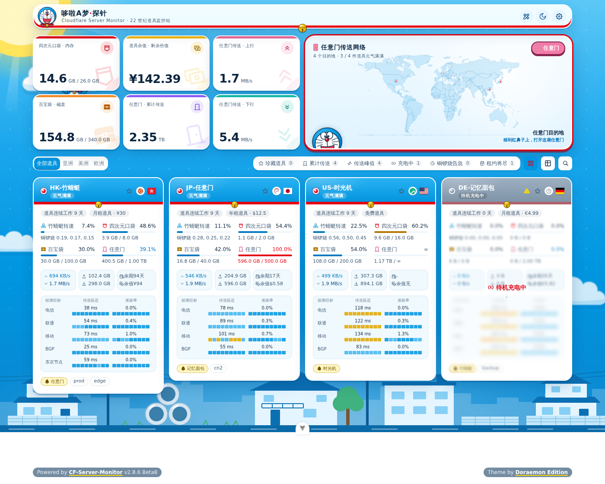
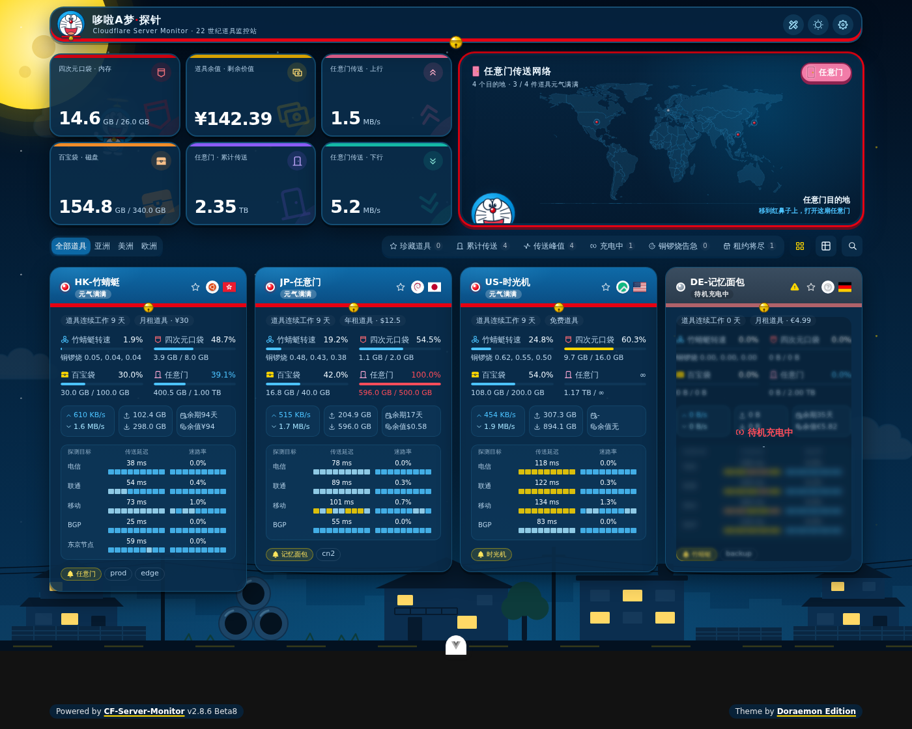
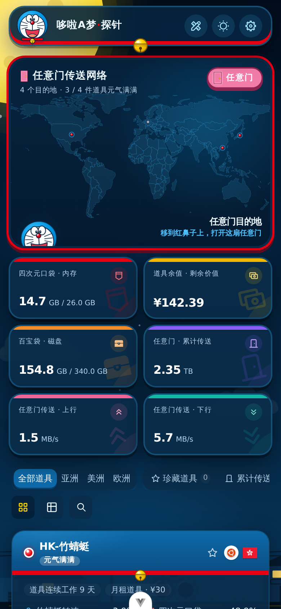
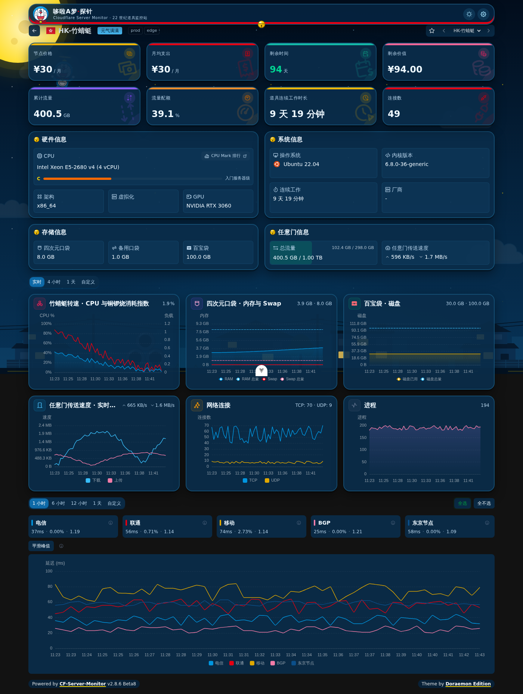
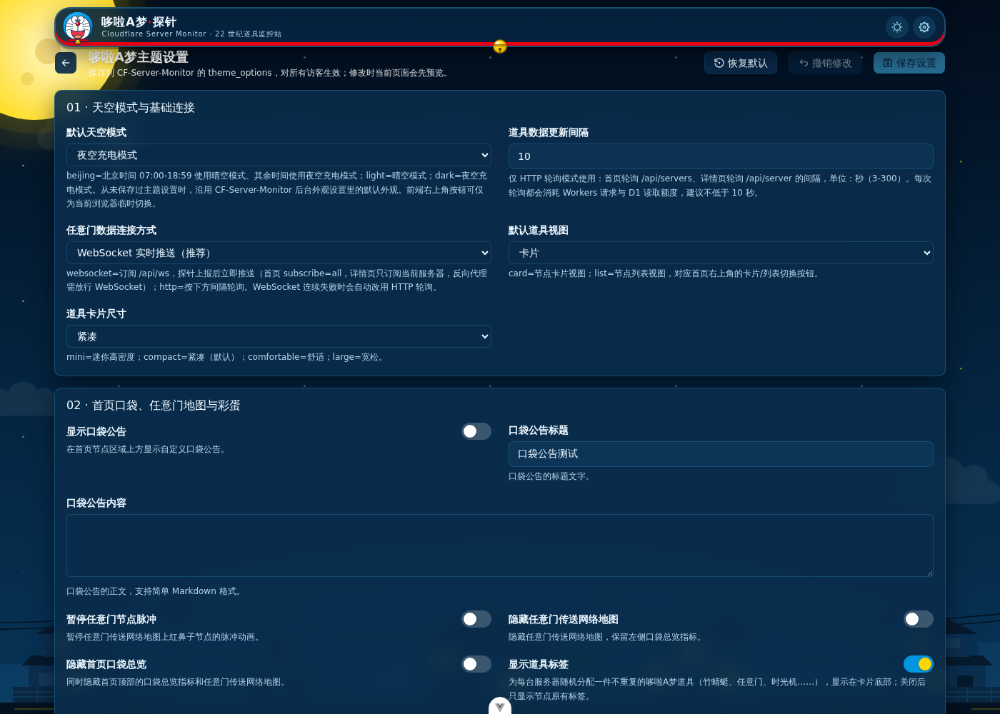

# 🔔 哆啦A梦探针 · CF-Server-Monitor 主题

> 一套给 [CF-Server-Monitor](https://github.com/huilang-me/CF-Server-Monitor) 用的哆啦A梦主题。服务器是一件件神奇道具，监控面板就是 22 世纪的道具监控站。
>
> 由 [极简探针版哆啦A梦主题](https://github.com/dongbo501/minimalist-probe-doraemon-theme) 移植而来，界面与彩蛋保持一致，数据层按 [CFSM 第三方主题开发文档](https://github.com/huilang-me/CF-Server-Monitor/blob/main/theme-develop.md) 重写。

<p align="center">
  
</p>

|                                夜空充电模式                                |                              移动端                              |
| :------------------------------------------------------------------------: | :--------------------------------------------------------------: |
|  |  |

|                              道具详情                               |                           主题设置（站长）                            |
| :-----------------------------------------------------------------: | :-------------------------------------------------------------------: |
|  |  |

## 📦 安装

在 CF-Server-Monitor 后台的 **主题商店** 页，把下面的地址填进「自定义主题 URL」：

```text
https://github.com/dongbo501/cfsm-doraemon-theme/tree/build
```

先点「预览」确认效果，再点「应用自定义」。`build` 分支由 GitHub Actions 在每次推送 `main` 后自动构建，只包含 CFSM 需要的 `index.html` 和 `assets/`。想固定某个版本，把 `build` 换成 `build` 分支上对应提交的完整 SHA 即可。

## ✨ 特色

- **哆啦A梦配色**：哆啦A梦蓝 `#0096E0` 做页面主体，卡片是不透明白色、深蓝文字；红色（鼻子、项圈）和金色（铃铛）做点缀。
- **哆啦A梦本体登场**：顶栏 Logo、加载页、地图左下角探头的都是哆啦A梦，天空里还有一只戴着竹蜻蜓的哆啦A梦慢慢飞过。
- **哆啦A梦节点卡**：蓝色的头、红项圈加金铃铛、白肚皮；离线节点显示灰色鼻子和「待机充电中」。
- **三网延迟小图**：后台开启「三网详情」后，首页卡片直接使用 `/api/servers` 附带的 2 小时延迟窗口，不为每张卡片额外查询历史。
- **任意门传送网络**：世界地图上用红鼻子标出服务器所在的国家或地区。
- **两个彩蛋**：点顶栏的哆啦A梦打开四次元口袋；点地图上的「任意门」，粉色的门会打开。
- **晴空 / 夜空充电模式**：按北京时间自动切换，也可以手动切换。

<details>
<summary>🗣️ 指标文案对照</summary>

| 监控指标        | 哆啦A梦文案                   |
| --------------- | ----------------------------- |
| CPU 占用        | **竹蜻蜓转速**                |
| 内存 RAM        | **四次元口袋**                |
| Swap            | **备用口袋**                  |
| 磁盘空间        | **百宝袋**                    |
| 网络流量 / 网速 | **任意门传送（上行 / 下行）** |
| 系统负载        | **铜锣烧消耗指数**            |
| 运行时间        | **道具连续工作时长**          |
| 在线 / 离线     | **元气满满 / 待机充电中**     |
| 延迟 / 丢包     | **传送延迟 / 迷路率**         |
| 到期提醒        | **租约将尽**                  |

图表标题和详情卡片也用同一套叫法，括号里保留原始术语，比如「竹蜻蜓转速 · CPU」。

</details>

## 🔌 与 CF-Server-Monitor 的对接

| 用途                 | 接口                                                                                 |
| -------------------- | ------------------------------------------------------------------------------------ |
| 站点配置、登录状态   | `GET /api/config`                                                                    |
| 首页服务器列表       | `GET /api/servers`                                                                   |
| 详情页               | `GET /api/server?id=`（不拉全量列表）                                                |
| 历史图表             | `GET /api/history/all?id=&hours=`（未登录最多 24 小时，登录后 7 天）                 |
| 实时推送             | `GET /api/ws`：首页 `subscribe=all` 并在通道内提交服务器 ID，详情页 `subscribe=<id>` |
| 保存主题设置（站长） | `POST /api/theme_options`                                                            |

- **路由**：首页 `/#/`，详情页 `/#/server/:id`，主题设置 `/#/theme-settings`；「后台管理」按钮跳转 `/admin#admin`，由 CFSM 内置主题接管。
- **静态资源**：主题自己的图片都在 `/assets/` 下；旗帜使用 CFSM 默认皮肤的 `/flags/<code>.svg`，系统图标使用 `/os-icons/<file>`，不打包进主题。
- **站点外观**：标题、图标、背景图、自定义 head / 脚本都由 CFSM 后台「外观设置」注入。后台设置了背景图时，主题会让出内置的天空背景。
- **Turnstile**：后台开启全局人机验证时，主题会弹出 Cloudflare Turnstile，验证后缓存 1 小时有效的凭证；凭证过期时自动重新验证。
- **非公开站点**：未登录访客会看到「站点未开放」提示和后台登录入口，不会被静默跳转。同域部署时 WebSocket 使用登录后的 `cfsm_auth` Cookie，跨域时在 URL 上附带 token。
- **省额度**：页面进入后台时关闭 WebSocket、回到前台先补一次 REST 数据再恢复；后台设置了「前端实时连接超时」时，到时关闭连接并由访客选择是否继续。WebSocket 连续失败会自动改用 HTTP 轮询。
- **页脚**：显示 `Powered by CF-Server-Monitor` 和 Workers 版本；站长登录后如有新版本会显示「可升级」。

## ⚙️ 主题设置

站长登录 CFSM 后台后回到首页，顶栏会出现 🎨 **主题设置** 按钮（`/#/theme-settings`）。设置项由 [`theme.json`](theme.json) 声明，修改时当前页面即时预览，保存后写入 CFSM 的 `theme_options`，对所有访客生效。

| 分组                          | 常用项                                                                |
| ----------------------------- | --------------------------------------------------------------------- |
| 01 天空模式与基础连接         | 晴空 / 夜空 / 按北京时间自动，WebSocket 或 HTTP 轮询，卡片 / 列表视图 |
| 02 首页口袋、任意门地图与彩蛋 | 口袋公告、隐藏任意门地图、道具标签、访客信息、卡片配色预设            |
| 03 首页口袋总览指标           | 顶部总览卡片显示哪些指标                                              |
| 04 道具工具箱与隐私           | 登录后才显示的拓扑、性价比、健康、导出工具；未登录时隐藏价格          |
| 05 道具卡片、列表与快捷筛选   | 快捷筛选按钮、铜锣烧告急阈值、租约将尽天数                            |
| 06 / 07 道具详情              | 详情页概览卡片和监控图表的组合                                        |
| 08 晴空 / 夜空自定义背景      | 用自己的图片或视频替换内置背景（优先于后台外观设置的背景图）          |

从未保存过主题设置时，默认天空模式沿用后台外观设置里的「默认外观」（浅色 / 深色）。

## 🌐 纯静态部署（可选）

主题也可以部署到 GitHub Pages 等静态托管，在 `index.html` 的 `<head>` 中加入后端地址（多个用英文逗号分隔）：

```html
<meta name="apiBase" content="https://status.example.com" />
```

并在每个 Worker 的环境变量 `CORS_ALLOWED_ORIGINS` 中加入主题所在的 origin。多个后端时，每台服务器只向返回它的后端查询历史和订阅推送。旗帜和系统图标仍按 `/flags/`、`/os-icons/` 路径加载，静态部署时需要自行提供这两个目录。

## 🛠️ 本地开发

需要 Node.js `^20.19.0` 或 `>=22.12.0`（运行 ESLint 需要 Node 22）。

```bash
npm install
# 开发服务器把 /api（含 WebSocket）、/flags、/os-icons 代理到这个 CFSM Worker；不设置时代理到 http://127.0.0.1:8787
CFSM_API=https://status.example.com npm run dev
npm run lint
npm run build     # 类型检查 + 构建 dist/（index.html + assets/）
```

代理到线上 Worker 时，请把 `http://localhost:5173` 加入该 Worker 的 `CORS_ALLOWED_ORIGINS`；也可以在 CFSM 仓库里用 `wrangler dev` 起一个本地 Worker。

## 🗂️ 主要目录

```text
src/utils/cfsm.ts                    CFSM 接口、字段转换、Turnstile、WebSocket
src/utils/init.ts                    启动流程与实时数据（按页面订阅、可见性、连接时长上限）
src/utils/rpc.ts                     历史指标与延迟数据
src/views/ThemeSettings.vue          站长主题设置页（按 theme.json 渲染）
src/components/TurnstileGate.vue     Cloudflare Turnstile 人机验证
src/components/DoraPocketStage.vue   首页地图舞台 + 四次元口袋 / 任意门彩蛋
src/components/Background.vue        晴空 / 夜空背景
public/assets/                       主题自带的哆啦A梦 SVG 与世界地图数据
theme.json                           主题设置声明
```

## 🙏 致谢与许可

- 监控系统：[CF-Server-Monitor](https://github.com/huilang-me/CF-Server-Monitor)。
- 移植自 [minimalist-probe-doraemon-theme](https://github.com/dongbo501/minimalist-probe-doraemon-theme)，它基于 [Gloria Universe 极简探针移植版](https://github.com/dongbo501/gloria-universe-monitor-theme) 重构；原主题是 [komari-theme-Gloria-Universe](https://github.com/TonyStarkJr2021/komari-theme-Gloria-Universe)，基础工程来自 [komari-theme-Glassmorphism](https://github.com/sanrokamlan-prog/komari-theme-Glassmorphism)。
- 代码沿用 MIT License。

这是一个粉丝向的非官方主题，与藤子・F・不二雄 Pro、小学馆等版权方没有任何关系。主题里的哆啦A梦形象以及铃铛、口袋、任意门、竹蜻蜓等图形都是用 SVG / CSS 绘制的同人造型，不含任何官方图片素材。「哆啦A梦」及相关道具名称的权利归其权利人所有。
